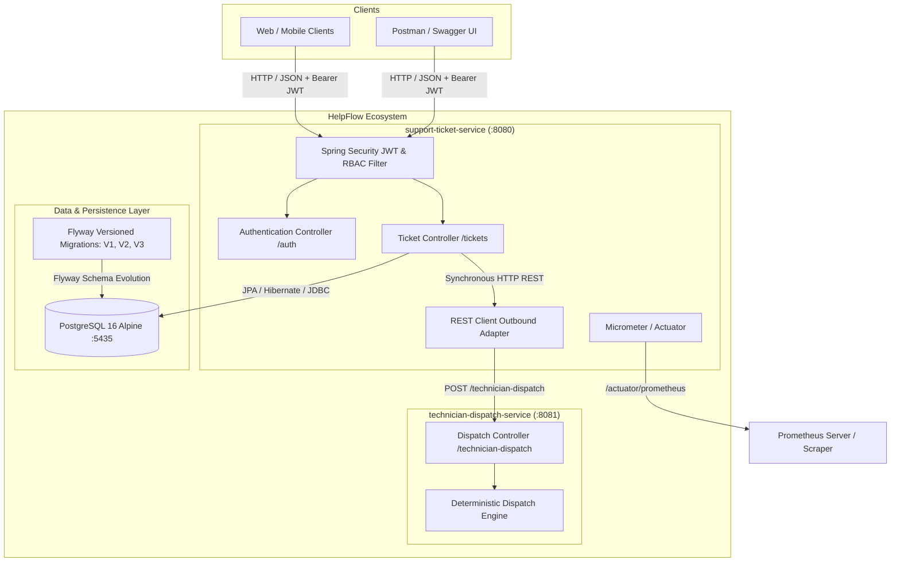
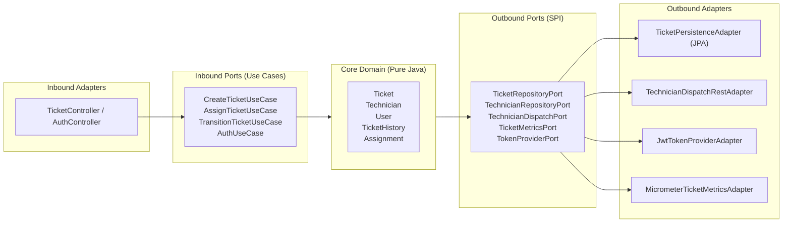
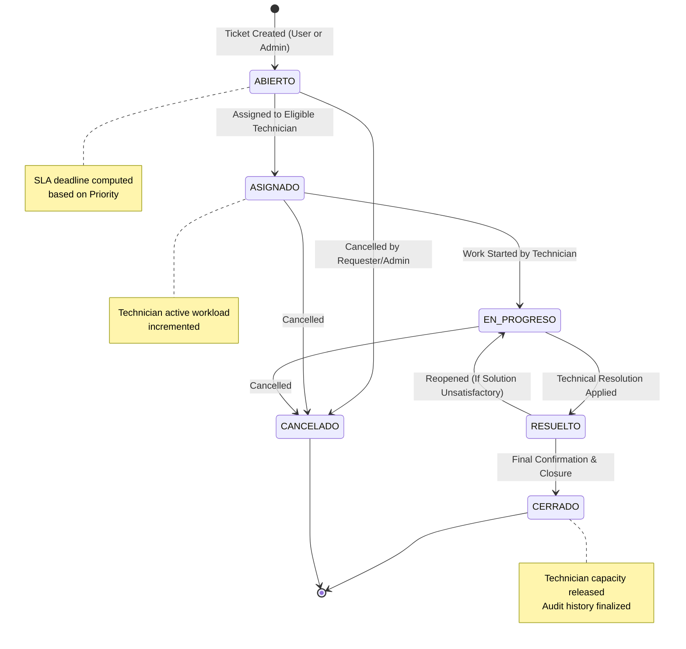

# 🚀 HelpFlow – Comprehensive IT Support Ticket Management System

> **Performance Assessment – Module 6: Advanced Backend Development with Spring Boot**  
> **Author:** Camilo  
> **Tech Stack:** Java 21 LTS | Spring Boot 3.4+ / 4.x | PostgreSQL 16 | Docker & Docker Compose | JJWT 0.12.6 | Micrometer & Prometheus | Flyway

---

## 📋 Table of Contents
1. [Project Overview](#-project-overview)
2. [System Architecture](#-system-architecture)
   - [Microservices Architecture Diagram](#microservices-architecture-diagram)
   - [Hexagonal Architecture (Ports & Adapters)](#hexagonal-architecture-ports--adapters)
3. [Ticket Lifecycle & State Machine](#-ticket-lifecycle--state-machine)
4. [Security & Role-Based Access Control (RBAC)](#-security--role-based-access-control-rbac)
5. [SLA Policies & Deterministic Dispatching](#-sla-policies--deterministic-dispatching)
6. [Observability & Metrics with Micrometer](#-observability--metrics-with-micrometer)
7. [Prerequisites & Deployment Guide](#-prerequisites--deployment-guide)
   - [Option 1: Full Deployment via Docker Compose (Recommended)](#option-1-full-deployment-via-docker-compose-recommended)
   - [Option 2: Local Development Execution](#option-2-local-development-execution)
8. [REST API Endpoint Catalog](#-rest-api-endpoint-catalog)
9. [Automated Testing Suite](#-automated-testing-suite)
10. [Interactive API Documentation (Swagger / OpenAPI)](#-interactive-api-documentation-swagger--openapi)
11. [Postman Collection](#-postman-collection)

---

## 📖 Project Overview

**HelpFlow** is an enterprise-grade distributed solution engineered to orchestrate incident intake, intelligent technical dispatching, lifecycle management, and auditing for Information Technology (IT) support operations.

The system is architected into two decoupled microservices:
1. **`support-ticket-service` (Port 8080):** The core transactional engine. Manages stateless JWT authentication, user and technician catalogs, PostgreSQL relational persistence, the ticket state machine, transition audit logs, and business metrics exposition via Micrometer.
2. **`technician-dispatch-service` (Port 8081):** An autonomous microservice implementing a deterministic assignment algorithm to compute technician availability and estimated resolution response times based on incident category, priority, and location.

---

## 🏛 System Architecture

### Microservices Architecture Diagram



---

### Hexagonal Architecture (Ports & Adapters)

Both microservices strictly follow **Hexagonal Architecture (Ports and Adapters)** and **Clean Architecture** principles:
- **Pure Domain:** Domain entities (`Ticket`, `Technician`, `User`, `Assignment`, and `TicketHistory`) contain zero dependencies on Spring or JPA annotations. They encapsulate domain rules, SLA calculations, and lifecycle invariants.
- **Inbound Ports:** Segregated use cases defining business intentions (`CreateTicketUseCase`, `AssignTicketUseCase`, `TransitionTicketUseCase`, `AuthUseCase`).
- **Outbound Ports:** Interfaces abstracting infrastructure concerns (`TicketRepositoryPort`, `TechnicianDispatchPort`, `PasswordEncoderPort`, `TokenProviderPort`, `TicketMetricsPort`).
- **Inbound Adapters:** REST controllers (`TicketController`, `AuthController`) validating request payloads and returning standardized RFC 7807 `ProblemDetail` error responses.
- **Outbound Adapters:** Spring Data JPA repositories with MapStruct mappers, JJWT 0.12.6 security provider, Micrometer metrics recorder, and Spring `RestClient`.



---

## 🔄 Ticket Lifecycle & State Machine

Each support ticket follows a strictly validated finite state machine at the domain level. Arbitrary transitions are rejected with descriptive domain exceptions.



---

## 🔐 Security & Role-Based Access Control (RBAC)

Authentication is completely **Stateless**, utilizing cryptographic **JWT (JSON Web Tokens)** signed with HMAC-SHA256 (`JJWT 0.12.6`). User passwords are protected using **BCrypt hashing (strength factor 10)**.

### Permission Matrix by Role

| Endpoint | Method | ROLE_USUARIO | ROLE_TECNICO | ROLE_ADMIN | Description |
| :--- | :---: | :---: | :---: | :---: | :--- |
| `/auth/register` | `POST` | Public | Public | Public | Register a new user in the system |
| `/auth/login` | `POST` | Public | Public | Public | Authenticate credentials and receive Bearer Token |
| `/tickets` | `POST` | ✅ | ❌ | ✅ | Create new support ticket |
| `/tickets` | `GET` | ✅ *(own tickets)* | ✅ *(assigned tickets)* | ✅ *(all tickets)* | Query and filter tickets |
| `/tickets/{id}` | `GET` | ✅ | ✅ | ✅ | Retrieve ticket details by ID |
| `/tickets/{id}/assign` | `POST` | ❌ | ❌ | ✅ | Assign ticket to dispatched technician |
| `/tickets/{id}/start` | `POST` | ❌ | ✅ | ✅ | Begin active ticket work |
| `/tickets/{id}/resolve` | `POST` | ❌ | ✅ | ✅ | Resolve ticket with technical notes |
| `/tickets/{id}/close` | `POST` | ✅ *(requester)* | ❌ | ✅ | Formally close resolved ticket |
| `/tickets/{id}/escalate`| `POST` | ❌ | ✅ | ✅ | Escalate ticket priority |
| `/tickets/{id}/cancel` | `POST` | ✅ | ❌ | ✅ | Cancel ticket with reason |
| `/actuator/**` | `GET` | ❌ | ❌ | ✅ | Health checks and system metrics |

---

## ⏱ SLA Policies & Deterministic Dispatching

### Service Level Agreement (SLA) Resolution Thresholds

| Priority | Resolution Time Limit (SLA) | Estimated Availability Level |
| :--- | :---: | :---: |
| **CRITICA** | **4 Hours** | `ALTA` (0 to 2 estimated hours response) |
| **ALTA** | **8 Hours** | `ALTA` / `MEDIA` (3 to 8 estimated hours response) |
| **MEDIA** | **24 Hours** | `MEDIA` (3 to 8 estimated hours response) |
| **BAJA** | **48 Hours** | `BAJA` (>8 estimated hours response) |

### Deterministic Dispatch Engine (`technician-dispatch-service`)
The `technician-dispatch-service` produces repeatable results for identical inputs by deriving a numeric seed from the `ticketId`, category (`HARDWARE`, `SOFTWARE`, `RED`, `ACCESOS`, `OTRO`), and priority:
- Dispatches the matching eligible technician.
- Enforces active workload limits (`currentActiveTickets < maxActiveTickets`).
- **Resilience Fallback:** If the external dispatch service is unreachable, `support-ticket-service` seamlessly engages an internal database fallback algorithm to assign the closest eligible technician without disrupting user workflows.

---

## 📈 Observabilidad & Metrics with Micrometer

The `support-ticket-service` exposes business-critical metrics captured via **Micrometer** and published in Prometheus format through Spring Boot Actuator:

| Metric Name | Type | Tags | Description |
| :--- | :---: | :--- | :--- |
| `helpflow.tickets.created.total` | Counter | `category`, `priority` | Total tickets created categorized by domain and priority |
| `helpflow.tickets.first_response.time`| Timer | - | Duration elapsed from ticket creation until technician assignment |
| `helpflow.tickets.resolution.time` | Timer | - | Total duration from ticket creation until technical resolution |
| `helpflow.tickets.sla_breached.total` | Counter | `category`, `priority` | Count of tickets that breached SLA resolution deadline |
| `helpflow.auth.failures.total` | Counter | - | Total failed authentication attempts (bad credentials) |
| `helpflow.auth.access_denied.total` | Counter | - | Total unauthorized access attempts intercepted (403 Forbidden) |

### Monitoring Endpoints
- **General Metrics Catalog:** `GET http://localhost:8080/actuator/metrics`
- **Specific Metric Details:** `GET http://localhost:8080/actuator/metrics/helpflow.tickets.created.total`
- **Prometheus Scrape Endpoint:** `GET http://localhost:8080/actuator/prometheus`
- **Health Check Endpoint:** `GET http://localhost:8080/actuator/health`

---

## 💻 Prerequisites & Deployment Guide

### System Requirements
- **Docker & Docker Compose** (version 24.0+ recommended)
- **Java JDK 21 LTS** (for local development and manual build)
- **Git**

---

### Option 1: Full Deployment via Docker Compose (Recommended)

From the project root directory, launch the entire ecosystem with a single command:

```bash
docker-compose up -d --build
```

This will automatically build and launch:
1. `helpflow-postgres`: PostgreSQL 16 Alpine database container mapped to host port `5435`.
2. `helpflow-technician-dispatch`: Standalone dispatch microservice on port `8081`.
3. `helpflow-support-ticket`: Core transactional microservice on port `8080`.

To stop all services while preserving volume data:
```bash
docker-compose down
```

---

### Option 2: Local Development Execution

#### 1. Start PostgreSQL Database
```bash
docker-compose up -d db
```

#### 2. Run `technician-dispatch-service` (Port 8081)
In a dedicated terminal:
```bash
cd technician-dispatch-service
./mvnw spring-boot:run
```

#### 3. Run `support-ticket-service` (Port 8080)
In another terminal:
```bash
cd support-ticket-service
./mvnw spring-boot:run
```

---

## 📡 REST API Endpoint Catalog

### 1. Authentication (`/auth`)

#### Register User
- **`POST /auth/register`**
- **Request Body:**
```json
{
  "document": "1000000004",
  "name": "Maria Lopez",
  "corporateEmail": "maria.lopez@helpflow.com",
  "password": "Password123!",
  "headquarters": "MEDELLIN",
  "department": "TALENTO_HUMANO",
  "role": "ROLE_USUARIO"
}
```
- **Response (201 Created):**
```json
{
  "id": 4,
  "document": "1000000004",
  "name": "Maria Lopez",
  "corporateEmail": "maria.lopez@helpflow.com",
  "headquarters": "MEDELLIN",
  "department": "TALENTO_HUMANO",
  "role": "ROLE_USUARIO",
  "status": "ACTIVO"
}
```

#### User Login
- **`POST /auth/login`**
- **Request Body:**
```json
{
  "corporateEmail": "admin@helpflow.com",
  "password": "Password123!"
}
```
- **Response (200 OK):**
```json
{
  "token": "eyJhbGciOiJIUzI1NiJ9.eyJzdWIiOiJhZG1pbkB...",
  "tokenType": "Bearer",
  "userId": 1,
  "corporateEmail": "admin@helpflow.com",
  "role": "ROLE_ADMIN"
}
```

---

### 2. Ticket Management (`/tickets`)

#### Create Ticket
- **`POST /tickets`**
- **Headers:** `Authorization: Bearer <TOKEN>`
- **Request Body:**
```json
{
  "requesterId": 1,
  "title": "Main core switch network disruption",
  "description": "Floor 3 switch unresponsive to ping and DHCP requests.",
  "category": "RED",
  "priority": "ALTA",
  "headquarters": "MEDELLIN",
  "affectedAsset": "SW-P3-MED"
}
```
- **Response (201 Created):**
```json
{
  "id": 1,
  "title": "Main core switch network disruption",
  "status": "ABIERTO",
  "category": "RED",
  "priority": "ALTA",
  "slaDeadline": "2026-10-28T04:14:00",
  "headquarters": "MEDELLIN",
  "affectedAsset": "SW-P3-MED"
}
```

#### Assign and Dispatch Technician
- **`POST /tickets/1/assign`**
- **Headers:** `Authorization: Bearer <ADMIN_TOKEN>`
- **Response (200 OK):**
```json
{
  "assignmentId": 1,
  "ticketId": 1,
  "technicianId": 14,
  "technicianName": "Carlos Redes",
  "assignedBy": "admin@helpflow.com",
  "availability": "MEDIA",
  "estimatedHours": 8,
  "notes": "Asignado al técnico Carlos Redes"
}
```

---

## 🧪 Automated Testing Suite

The codebase features **42 comprehensive automated tests** validating all domain invariants, state machine transitions, dispatch heuristics, and security filters using isolated in-memory test profiles (**H2** in PostgreSQL compatibility mode) and **Testcontainers** configuration.

### Run tests in `support-ticket-service`:
```bash
cd support-ticket-service
./mvnw test
```
**Output:** `Tests run: 39, Failures: 0, Errors: 0, Skipped: 0` (`BUILD SUCCESS`)

### Run tests in `technician-dispatch-service`:
```bash
cd technician-dispatch-service
./mvnw test
```
**Output:** `Tests run: 3, Failures: 0, Errors: 0, Skipped: 0` (`BUILD SUCCESS`)

---

## 📚 Interactive API Documentation (Swagger / OpenAPI)

Once the services are running, interactive Swagger UI documentation is available directly in the browser:

- 📑 **Swagger UI - Support Ticket Service:**  
  [http://localhost:8080/swagger-ui.html](http://localhost:8080/swagger-ui.html)  
  *(Authorize requests by clicking `Authorize` and entering `Bearer <TOKEN>`)*
- 📑 **Swagger UI - Technician Dispatch Service:**  
  [http://localhost:8081/swagger-ui.html](http://localhost:8081/swagger-ui.html)

---

## 📦 Postman Collection

A complete, pre-configured Postman collection with dynamic environment variables is available in the repository:
- **File Location:** `postman/HelpFlow_API.postman_collection.json`
- **Key Features:**
  1. Automated JWT Bearer token capture and storage across requests.
  2. Complete request folders for Authentication, Ticket Management, Dispatching, State Transitions, and Observability.
  3. Pre-populated realistic payloads matching production schemas.